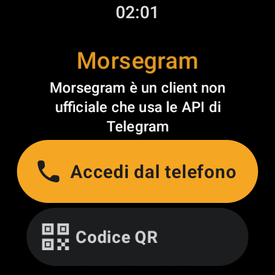
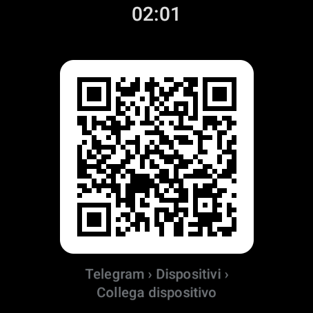

<p align="center">
  
</p>

<p align="center">
  <b>Veloce. Privato. A modo tuo.</b><br>
  Un client non ufficiale per Telegram, per telefono, orologio e auto.
</p>

---

## Cos'è

**Morsegram** è un client Android non ufficiale che usa le API di Telegram. Non è affiliato a Telegram FZ-LLC. È un fork dell'app ufficiale ([DrKLO/Telegram](https://github.com/DrKLO/Telegram)) con un'idea precisa: togliere quello che rallenta e aggiungere quello che serve davvero, senza toccare il modo in cui Telegram funziona per gli altri.

## Cosa fa di diverso

| | |
|---|---|
| ⚡ **Veloce** | Niente Storie, regali, Stars, wallet o AI caricati all'avvio: si parte e basta. |
| 📌 **Pin illimitati** | Fissa in alto quante chat vuoi, oltre il limite del server. I pin extra restano su questo dispositivo. |
| 🔒 **Chat nascoste** | Chat protette da PIN e impronta, invisibili in lista, ricerca e condivisione. Le notifiche diventano un generico "Nuovo messaggio". |
| 🎙️ **Trascrizione dei vocali** | Da voce a testo **sul telefono**, senza Premium e senza mandare l'audio a nessuno. |
| ✈️ **Modalità aereo interna** | Un interruttore (anche nelle impostazioni rapide) che sospende solo Morsegram: niente rete, niente notifiche. Il telefono resta connesso. |
| 📱 **Pensato per i pieghevoli** | Due pannelli sullo schermo interno, divisore sulla piega, la chat aperta resta dov'era quando apri e chiudi. |
| ⌚ **App per Wear OS** | App vera sull'orologio: chat, foto, **ascolto e invio di messaggi vocali**, risposta rapida, notifiche. |
| 🚗 **Android Auto** | Scegli la chat dal display dell'auto e ascolti i vocali; l'assistente legge i messaggi e rispondi a voce. |

## Privacy

Nessuna telemetria, nessun analytics, nessun server nostro: l'app parla solo con Telegram, come quella ufficiale. La trascrizione dei vocali avviene sul dispositivo. Il codice è qui, pubblico, e si compila da sé.

Morsegram **non** include e non includerà "modalità fantasma", spunte di lettura falsate o stati online nascosti: sono vietati dai termini delle API di Telegram e farebbero chiudere il progetto.

## Scarica

| | |
|---|---|
| **Telefono (APK)** | [`dist/Morsegram-telefono.apk`](dist/) — installazione diretta, Android 6+ (arm64) |
| **Play Store (AAB)** | [`dist/Morsegram-playstore.aab`](dist/) — il pacchetto da caricare su Google Play |
| **Orologio (APK)** | [`dist/Morsegram-wear.apk`](dist/) — Wear OS 3+ |

L'app si installa **accanto** a Telegram ufficiale: pacchetto `it.morsegram.app`, puoi tenerle entrambe.

## Immagini

<p align="center">
  
  
</p>

## Compilare

Serve Android Studio 2025.1.4, SDK 36, NDK 27.2.12479018. Le credenziali (api_id, api_hash, keystore) vanno in `~/.gradle/gradle.properties`, mai nel repository:

```properties
MORSEGRAM_APP_ID=<il tuo api_id>
MORSEGRAM_APP_HASH=<il tuo api_hash>
RELEASE_STORE_FILE=<percorso del keystore>
RELEASE_STORE_PASSWORD=…
RELEASE_KEY_ALIAS=…
RELEASE_KEY_PASSWORD=…
```

```bash
./gradlew :TMessagesProj_App:assembleAfatRelease     # telefono
./gradlew :TMessagesProj_Wear:assembleRelease        # orologio
./gradlew :TMessagesProj_App:bundleAfatRelease       # pacchetto per Play
```

Dettagli, elenco delle modifiche rispetto all'app ufficiale e procedura di aggiornamento: [`MORSEGRAM.md`](MORSEGRAM.md). Istruzioni originali di upstream: [`BUILD-upstream.md`](BUILD-upstream.md).

## Licenza

GNU GPL v2 o successiva, come l'app ufficiale di Telegram da cui deriva: il codice sorgente di ogni versione distribuita è pubblicato qui. Vedi [`LICENSE`](LICENSE).

Telegram è un marchio di Telegram FZ-LLC. Morsegram non è un prodotto Telegram.
